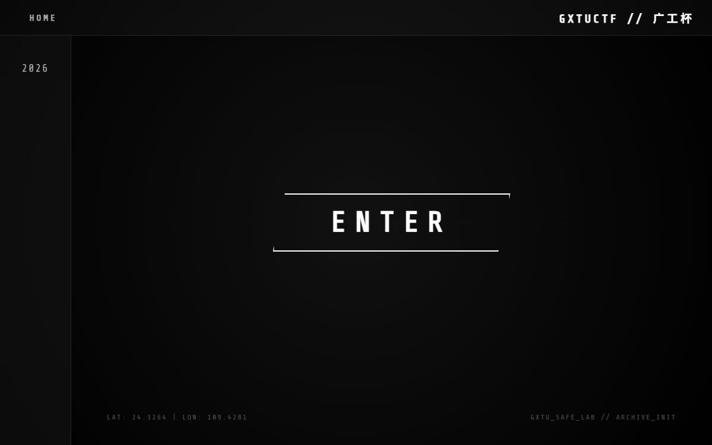
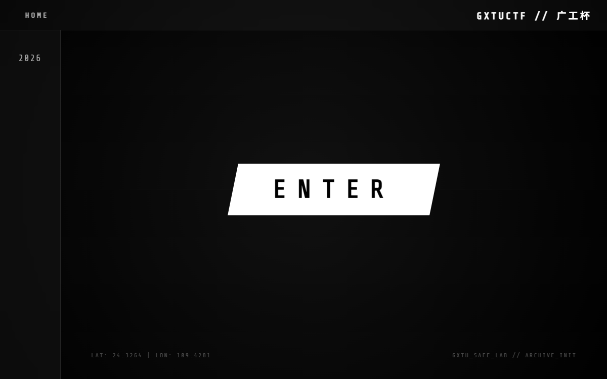
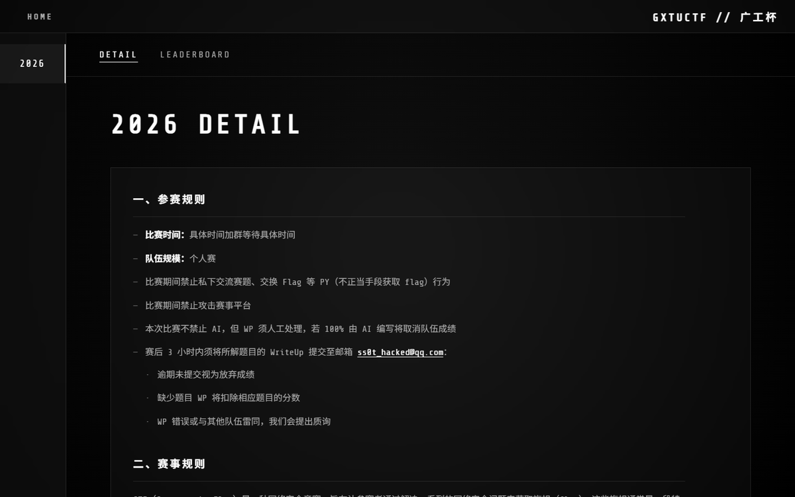
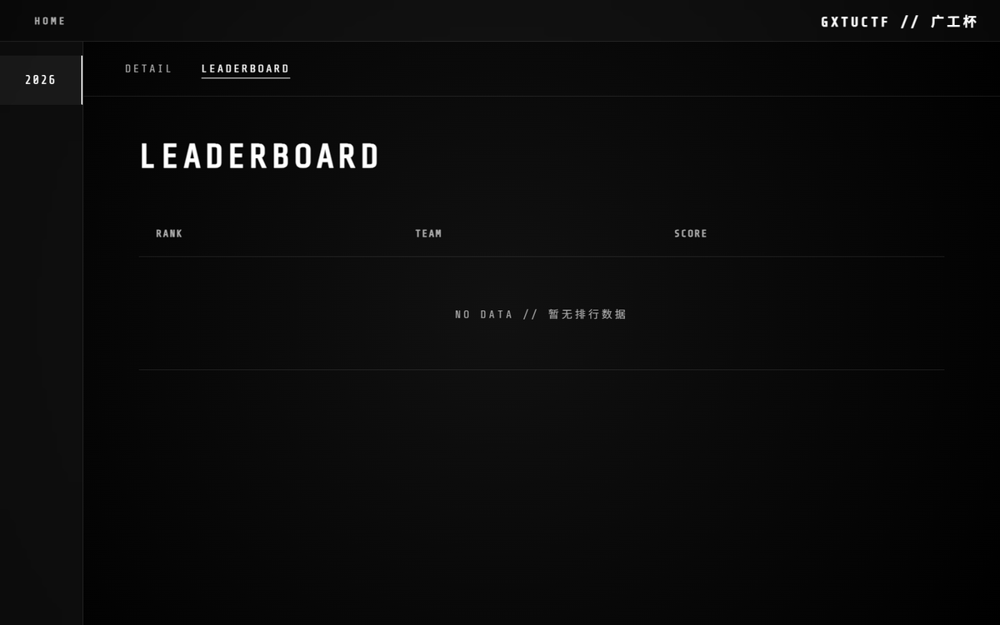

# 广工杯 2026 · GXTUCTF ARCHIVE

一个纯静态的单页赛事归档站：黑底终端风、文字解码动画、视图淡入淡出、霓虹式 hover 效果。
视觉与动效参照 <https://www.ctf.vin/>（MilkDragonCTF 落地页）复刻，品牌为「广工杯 / GXTUCTF」。



| 首页（ENTER hover 反色） | 2026 DETAIL |
| --- | --- |
|  |  |
| **LEADERBOARD** | |
|  | |

## 快速开始

**最简单**：双击 `index.html` 用浏览器打开即可（字体已 base64 内嵌，`file://` 下也能正常显示）。

**推荐**（本地服务）：

```bash
# 在本目录执行
python -m http.server 8000
# 浏览器访问 http://127.0.0.1:8000/
```

部署：整目录上传到任意静态托管（Vercel / Netlify / GitHub Pages / Nginx）即可，无需构建。

## 目录结构

```
.
├── index.html              # 页面结构（两个视图：home / data）
├── styles.css              # 全部样式与动画
├── script.js               # 数据 + TextScramble 动画 + 交互逻辑
├── assets/
│   ├── favicon.svg         # 站点图标（黑底白 >_ 终端风）
│   └── fonts/
│       ├── fonts.css       # Share Tech Mono 的 @font-face（base64 内嵌，离线可用）
│       ├── ShareTechMono-Regular.woff2
│       └── build-font-css.mjs   # 由 woff2 重新生成 fonts.css 的脚本
├── ANIMATION-NOTES.md      # 动效逐项拆解与调参说明
├── docs/                   # 截图（README 引用）
└── qa/                     # 验收工具与证据（可整个删除，不影响站点运行）
    ├── shoot.mjs           # 零依赖 CDP 截图工具
    ├── report-clone-v2.md  # 当前版本验收报告
    ├── report-original.md  # 原站动效实测报告
    └── original/ clone-v2/ …   # 各状态截图
```

## 页面内容

- **首页**：四角装饰小字 + ENTER 按钮（hover 反色、字距扩张、辉光、重触发解码）
- **数据页**（点侧栏的 2026 进入）：
  - `DETAIL` 赛事简介 · `LEADERBOARD` 排行榜

## 改造成你自己的赛事

所有可改的东西都在 `script.js` 顶部与 `index.html` 的几行装饰文字里：

| 想改什么 | 改哪里 |
| --- | --- |
| 品牌名（顶栏 + 解码动画文案） | `script.js` → `CONFIG.brand` |
| ENTER 按钮跳转地址 | `script.js` → `CONFIG.enterUrl` |
| 赛事详情正文（支持 HTML） | `script.js` → `DATABASE["2026"].detail` |
| 排行榜数据 | `script.js` → `DATABASE["2026"].rank` |
| 首页四角装饰小字（含坐标） | `index.html` → `.home-decor` 四行（纯装饰，随便改） |
| 主色 / 模糊半径 / 缓动曲线 | `styles.css` → `:root` 变量 |

DETAIL 正文是富文本，可用的结构（样式在 `styles.css` 的 `.detail-body`）：

```html
<h4>一、参赛规则</h4>          <!-- 大节标题：白字 + 下划线 -->
<ul><li>条目</li></ul>          <!-- 一级列表用「—」，嵌套的二级列表用「·」 -->
<h5>特别奖项</h5>               <!-- 小节标题 -->
<table class="minimal-table">   <!-- 表格照抄现有奖项表的写法即可 -->
  <thead><tr><th>列名</th></tr></thead>
  <tbody><tr><td>值</td></tr></tbody>
</table>
```

> ⚠️ 目前**排行榜是空的**（`rank: []`），表格会显示 `NO DATA // 暂无排行数据` 占位行。
> 填数据的方法见下节。

> 🔗 ENTER 按钮已指向赛事报名页：`https://youyue.info/competition_detail.php?id=6`
> （配置项 `CONFIG.enterUrl`）。若将来改回占位 `#`，脚本会自动阻止跳转，不会打开空白副本。

### 填排行榜数据

打开 `script.js`，按格式往 `DATABASE["2026"].rank` 数组里加对象即可（顺序 = 显示顺序，`rank` 建议两位补零）：

```js
rank: [
    { rank: "01", name: "队伍甲", score: "13501" },
    { rank: "02", name: "队伍乙", score: "13001" },
]
```

数组非空时占位行自动消失；清空回 `rank: []` 又会回到 NO DATA 状态。

### 增加一个年份

```js
// script.js
const DATABASE = {
    "2027": {                       // 键会在左侧栏自动出现（倒序排列）
        detail: "赛事简介……",
        rank: [{ rank: "01", name: "队伍名", score: "5000" }],
        sponsors: [{ name: "赞助商", url: "https://example.com" }],
        wp: "https://…",            // WRITEUPS 链接
        github: "https://…"         // GITHUB 链接
    },
    "2026": { /* … */ }
};
```

## 浏览器支持

Chrome / Edge / Firefox / Safari 现代版本。
用到 `backdrop-filter`（玻璃拟态）、`clip-path`（按钮斜切角）——
旧版浏览器会退化为无模糊/无斜切，不影响功能。

已适配 `prefers-reduced-motion`：系统开启「减少动态效果」时，文字解码直接落字、旋转描边停止。

## 相对原站的差异

- 品牌与数据：MilkDragonCTF / 奶龙杯 → 广工杯 / GXTUCTF；只保留 2026 一个年份。
- 原站有「证书查询」模块，本站在需求变更后**已整体移除**（页面、样式、脚本、资源均无残留）。
- 补了 `assets/favicon.svg`（原站 favicon 是 404）。
- 其余视觉、动画、布局、响应式断点与原站保持一致：**首页静止态整帧像素比对 0 差异**。

详细验收数据见 [qa/report-clone-v2.md](qa/report-clone-v2.md)。

## 许可

- 页面代码：可自由修改使用。
- 字体 Share Tech Mono：SIL Open Font License 1.1（见 `assets/fonts/fonts.css` 头部注释）。
- 动效设计的原始出处是 <https://www.ctf.vin/>，本项目为学习目的的复刻实现，请勿直接搬运对方的品牌与赛事数据。

动效细节见 [ANIMATION-NOTES.md](ANIMATION-NOTES.md)。
